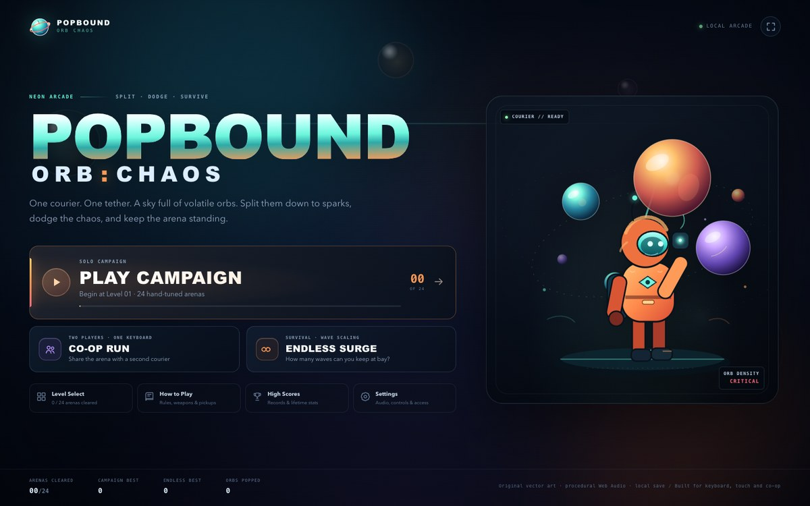
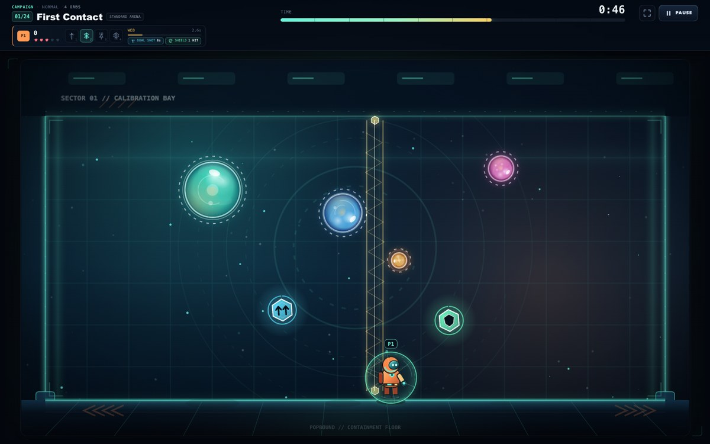
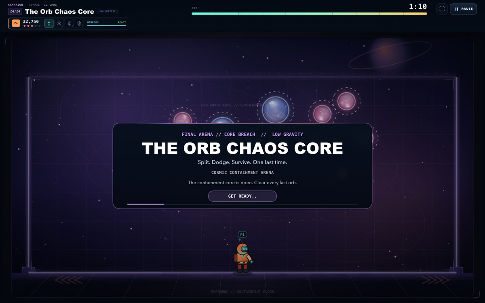
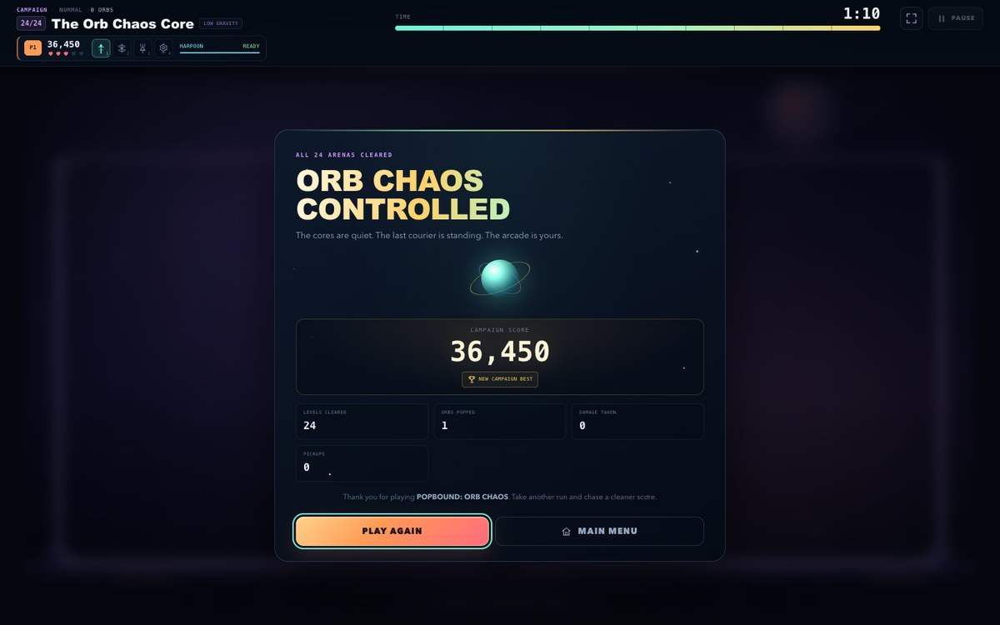
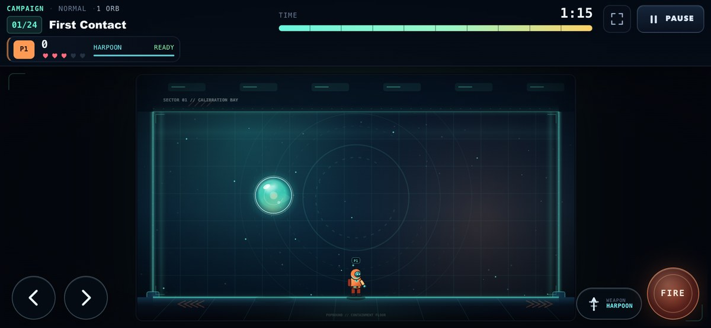

# POPBOUND: ORB CHAOS

**Split. Dodge. Survive.**

A complete, original neon-arcade bubble-splitting survival game for the browser. You play a
futuristic arcade courier on the floor of a containment arena, firing vertical weapons into a
sky of glossy, volatile orbs. Every orb you hit splits into two smaller, faster orbs. Clear the
arena before the clock expires, dodge the shards, grab salvage, and keep moving.

Built with React, TypeScript, Vite, HTML5 Canvas 2D and procedural Web Audio. No backend,
no accounts, no API keys and no downloaded art or audio assets.

[](https://hassanabni.github.io/popbound-orb-chaos/)
[](https://github.com/hassanabni/popbound-orb-chaos/actions/workflows/deploy-pages.yml)

**Live game:** <https://hassanabni.github.io/popbound-orb-chaos/>



## What's in the game

- **24-level single-player campaign** across five fully themed arenas, with unique titles,
  layouts, tier mixes, timers, speed multipliers, pickup rates, level modifiers and completion
  bonuses.
- **Four weapons** with distinct behaviour, visuals, cooldowns and sound design:
  Pulse Harpoon, Anchor Web, Prism Beam and Arc Mine.
- **Six salvage pickups**: Dual Shot, Energy Shield, Freeze Burst, Time Surge, Extra Life and
  Score Crystal.
- **Recursive four-tier orb splitting** with swept projectile collision, spawn guards to prevent
  duplicate scoring, and arcade-tuned gravity/restitution physics.
- **Local two-player co-op** on one keyboard, with independent scores, lives, weapons and
  simultaneous input.
- **Endless survival** with data-driven wave scaling, shifting arena themes, escalating speeds,
  recorded best wave, and a save-safe run score.
- **Level select** with legitimate sequential unlocks, locked states, per-level best scores and
  campaign completion records.
- **Complete UI**: main menu, mode launchers, HUD, pause menu, time-up flow, level-complete
  summary, game over, campaign victory, level select, high scores, how-to-play, settings, key
  rebinding and reset-progress confirmation.
- **Accessibility and comfort**: reduced motion, high-contrast gameplay, screen-shake toggle,
  keyboard focus states, semantic dialogs, live announcements and persistent preferences.
- **Responsive/mobile support**: touch movement, hold-to-fire, weapon cycling, pause, automatic
  rotate recommendation in portrait, DPR-aware crisp Canvas, and a usable fullscreen mode.
- **Persistence**: versioned localStorage save for progression, per-level bests, high scores,
  settings and bindings, with defensive validation and safe fallbacks for corrupt data.
- **Procedural art and audio**: every character, orb, arena, pickup, icon and menu graphic is drawn
  with Canvas or original SVG; every sound effect and the ambient music pad are synthesized live.

| Gameplay | Final arena |
| --- | --- |
|  |  |

| Campaign victory | Mobile landscape |
| --- | --- |
|  |  |

## Play it live

The current build is hosted on **GitHub Pages**:

### <https://hassanabni.github.io/popbound-orb-chaos/>

No install is needed to play. Progress, settings and key bindings are stored in that browser's
localStorage; clearing site data or playing on another browser starts a fresh local save.

Deployment is automatic. Every push to `main` runs the automated tests, builds the production
bundle and publishes `dist/` through GitHub Actions. The workflow is in
[`.github/workflows/deploy-pages.yml`](.github/workflows/deploy-pages.yml). To redeploy manually,
open **Actions → Deploy to GitHub Pages → Run workflow** in the repository.

The production build uses relative asset paths (`base: './'`), so the same `dist/` works from the
GitHub Pages project subpath or from any static host without server-side routing.

## Quick start (local)

Requires **Node.js 20.19 or newer** (Node 22 LTS recommended).

```bash
npm install
npm run dev
```

Open the URL printed by Vite (by default **http://localhost:5173/**).

Production build and preview:

```bash
npm run build
npm run preview
```

Run the automated tests:

```bash
npm test
```

Type-check only:

```bash
npm run typecheck
```

The project includes a local npm cache configuration in `.npmrc`, so installs do not depend on the
state of a machine-wide npm cache. `.npm-cache/`, `node_modules/` and `dist/` are gitignored.

The same commands are used by GitHub Actions in the Pages deployment pipeline (`npm ci`,
`npm test`, `npm run build`).

## Controls

### Single-player / Player 1

| Action | Default key |
| --- | --- |
| Move left / right | `←` / `→` |
| Fire (hold to auto-fire) | `Space` |
| Pulse Harpoon | `1` |
| Anchor Web | `2` |
| Prism Beam | `3` |
| Arc Mine | `4` |
| Pause / resume | `Esc` or `P` |

### Player 2 (local co-op)

| Action | Default key |
| --- | --- |
| Move left / right | `A` / `D` |
| Fire (hold to auto-fire) | `Q` |
| Pulse Harpoon | `7` |
| Anchor Web | `8` |
| Prism Beam | `9` |
| Arc Mine | `0` |

All movement, fire and weapon keys can be rebound independently for both players in
**Settings → Controls**. `Esc`/`P` are reserved for pause. Bindings apply immediately, including
mid-run, and are persisted in localStorage.

### Touch

On touch devices, or with **Settings → On-screen controls → Always**:

- Hold `◀` / `▶` to move continuously.
- Hold **FIRE** to auto-fire.
- Tap the **WEAPON** pill to cycle through all four weapons; its label shows the current weapon.
- Pause is always available in the top HUD.

Touch controls are placed in the side gutters on wide landscape phones and below the arena on
portrait screens. Portrait play is supported, with a recommendation to rotate for a larger arena.
In two-player co-op, the touch pad drives Player 1 only; two-player local play needs a keyboard.

## Rules at a glance

- **Orb tiers:** Tier 0 is large and slow; tier 3 is tiny and fast. Each hit removes the orb.
  Tiers 0–2 split into exactly two orbs of the next tier; tier 3 pops permanently.
- **Physics:** fixed 120 Hz simulation with a gravity/restitution model. Orbs bounce off walls,
  floor and ceiling. Larger orbs rebound higher; smaller orbs rebound lower but move faster
  horizontally so they stay shootable and threatening.
- **Lives:** Easy starts with 4, Normal with 3, Hard with 2. Extra Life pickups can push above the
  starting amount up to the HUD maximum. A hit grants 2.2 seconds of invulnerability and a safe
  respawn lane.
- **Shield:** absorbs one incoming orb hit, then grants a short invulnerability window.
- **Timer:** each level has a countdown and progress bar, with warnings in the final seconds. If
  time expires, every active courier loses a life; the arena then resets with a fresh clock. The
  current attempt's score is returned to the level starting score so time-outs cannot farm points.
- **Scoring:** Tier 0 = 10, tier 1 = 20, tier 2 = 35, tier 3 = 60. Clears add a level bonus plus
  10 points per remaining second, and useful pickups award bonus points. Each orb can score once.
- **Level clear:** the arena is complete only when zero orbs remain.
- **Campaign:** clearing a level unlocks the next. The difficulty setting affects lives, timers,
  orb speed and pickup rates for new runs and level restarts.
- **Co-op:** both players share the arena and timer but have separate scores and lives. A downed
  player does not end the run; the other can clear the arena. Both return on the next level. Game
  over occurs only when both are down at the same time.
- **Endless:** waves scale in orb count, tier mix, speed and timer pressure. Clearing a wave banks
  the wave and time bonuses, records the best wave immediately, then spawns the next containment
  surge. A timeout costs a life and restarts the current wave with its wave score reset. The run
  ends when lives reach zero.

## Weapons

| Slot | Weapon | Behaviour | Cooldown |
| --- | --- | --- | --- |
| 1 | **Pulse Harpoon** | Fast vertical tether. Splits the first orb in its path, lingers briefly, and leaves a bright trail. | 0.34 s |
| 2 | **Anchor Web** | Full-height energy lattice anchored floor-to-ceiling for ~3.1 s. Splits every orb that touches it; each orb once per cast. | 3.2 s |
| 3 | **Prism Beam** | Instant full-column beam that splits every orb in its band. Deduplicated, predictable multi-hits. | 0.72 s |
| 4 | **Arc Mine** | Places an arming trap near the courier. Detonates on orb contact, splitting everything in its radius, or expires unused. Max two active. | 2.1 s |

Dual Shot duplicates the next firing effect: two tethers, two webs, two beams or two mines.

## Pickups

| Pickup | Effect |
| --- | --- |
| **Dual Shot** | Two tethers/beams/mines for 11 seconds. |
| **Energy Shield** | Blocks the next orb contact. Shown as a bright shield bubble. |
| **Freeze Burst** | Freezes all ordinary orb movement for 5.5 seconds; the player can still move and fire. |
| **Time Surge** | Adds up to 10 seconds to the level clock, never above the configured maximum. |
| **Extra Life** | +1 life up to the displayed maximum; converts to points at max. |
| **Score Crystal** | +150 points. |

Pickups fall with gravity, bounce/settle, expire after about 13 seconds, blink when nearly gone,
and pause their lifetimes with the rest of the simulation. They are collected by the player who
touches them, with balanced drop weights, a per-drop cooldown and a max-active cap.

## Level modifiers

- **Standard Arena** — baseline physics.
- **Low Gravity** — slower arcs; orbs hang in the air longer.
- **Turbulence** — faster horizontal drift.
- **Rich Drops** — more frequent pickups.
- **Sudden Speed** — orbs gain extra pace when the clock drops below 15 seconds.

The final arena adds its own containment-core presentation and a custom READY banner.

## Project structure

```text
src/
  App.tsx                 Application flow, persistence callbacks, fullscreen, settings modal
  main.tsx                React entry point
  styles.css              Complete responsive menu/HUD/overlay design system
  game/
    GameEngine.ts         Simulation, fixed-step loop, inputs, collisions, run/state machine
    render.ts             Canvas renderer: themes, characters, orbs, weapons, effects, overlays
    types.ts              Domain model, save/event/HUD types
    constants.ts          Tuning: arena, physics, difficulty, living defaults, bindings
    physics.ts            Pure collision, bounce, movement and segment/geometry helpers
    levels.ts             Data-driven campaign, spawn generation/validation, endless scaling
    weapons.ts            Weapon definitions and cooldown/visual metadata
    pickups.ts            Pickup definitions, drop weights and effect metadata
    themes.ts             Five original arena palettes and identities
    audio.ts              Procedural Web Audio synth graph, SFX and ambient music
    input.ts              Keyboard/touch state, bindings and stuck-key protection
    storage.ts            Versioned localStorage load/save, validation and progression helpers
  ui/
    MainMenu.tsx          Logo, mode launchers, progress and utility navigation
    GameSession.tsx       Engine lifecycle, event-to-save bridge, HUD/overlay composition
    GameCanvas.tsx        Aspect-fit canvas wrapper and engine attach/detach
    Hud.tsx               Timer, lives, scores, weapon dock, cooldowns and power-up chips
    TouchControls.tsx     Multi-pointer touch pad with cleanup and pointer capture
    overlays.tsx          Pause, time-up, wave clear, level clear, game over, victory, confirms
    SettingsPanel.tsx     Audio/gameplay/access settings, key rebinding and progress reset
    HowToPlay.tsx         Complete field manual
    LevelSelect.tsx       Unlock-aware campaign archive
    HighScores.tsx        Best scores, per-level records and lifetime stats
    CoopIntro.tsx         Co-op briefing and control reference
    icons.tsx             Original SVG iconography and menu hero illustration
    common.tsx            Shared controls, formatting hooks and screen headers
tests/
  engine.test.ts          Splitting, weapons, pickups, damage, timer, pause, co-op, endless
  physics.test.ts         Bounce boundaries, swept collision, movement, respawn lanes
  levels.test.ts          All 24 levels validated, spawn safety, endless scaling to 40 waves
  storage.test.ts         Persistence, sanitisation, unlocking, reset, high scores
  loop.test.ts            Canvas lifecycle and duplicate-loop prevention (jsdom)
  bot.test.ts             Deterministic full 24-level campaign completion run
scripts/                  Optional Playwright QA harnesses (desktop, mobile, fullscreen)
docs/                     README screenshots
.github/workflows/
  deploy-pages.yml        Test, build and deploy the playable build to GitHub Pages
```

### Engine architecture

`GameEngine` is deliberately independent of React and the Canvas renderer. React manages menus,
overlays, settings and application-level routing; it subscribes to immutable HUD snapshots via
`useSyncExternalStore`. The engine owns:

- a fixed-step `requestAnimationFrame` loop with a delta cap and substep cap,
- input sampling, movement, weapons and cooldowns,
- orb spawning/physics/collision and recursive splitting,
- pickups, power-up clocks, particles/score popups,
- run state: READY → PLAYING → PAUSED / TIME_UP / WAVE_COMPLETE / LEVEL_COMPLETE /
  GAME_OVER / CAMPAIGN_COMPLETE,
- progression events (`level-complete`, `game-over`, `wave-complete`, `campaign-complete`) that
  the UI persists only after the engine has confirmed them.

The renderer is a separate Canvas 2D module that reads engine state and draws a 1280×720 virtual
playfield, letterboxed and scaled with device-pixel-ratio awareness. Backgrounds and glossy orb
sprites are cached per theme/tier. Inputs, SFX and persistence are also modular.

### Persistence

Save data is stored under:

```text
popbound.orbchaos.save.v1
```

It contains highest unlocked level, completed levels, per-level best scores, campaign/co-op/endless
bests, best endless wave, victory flags, lifetime stats, settings, key bindings and the last run.
Every load is validated and clamped; missing/corrupt/outdated data falls back to safe defaults.
Progress resets are available in **Settings → Local save → Reset progress** and preserve audio,
accessibility and key-binding preferences.

Clearing browser storage resets the game to a fresh save. On GitHub Pages, the live build uses the
same local save model, so each visitor gets their own independent progress on that device.

## Testing and verification

The repository includes **66 Vitest tests across 6 files**. They cover:

- exact two-child splitting for tiers 0–2 and permanent removal of tier 3,
- one score award per hit, spawn guards and duplicate-hit prevention,
- swept fast-projectile collision, wall/floor/ceiling bounces, never falling through the floor,
- player movement acceleration, arena bounds and safe respawn lanes,
- all four weapons, Arc Mine arming/detonation, dual-shot duplication,
- all five core pickups plus the crystal,
- temporary invulnerability and shield absorption,
- pause freezing the timer, physics, cooldowns, pickup TTLs and power-up clocks,
- time-out life loss and attempt-score reset, game over, retry and all-lives conditions,
- level completion events and exact bonuses, co-op survival/elimination/revival rules,
- endless wave progression and endless game over,
- data validation, progression updates that never reduce unlocks, settings/bindings persistence,
- Canvas attach/destroy behavior and prevention of duplicate animation loops.

A deterministic **headless campaign bot** (`tests/bot.test.ts`) plays through all 24 levels using
only normal movement, held fire, weapon selection, live orb data and the engine's timers. It uses
accelerated stepping and the game's own retry/restart rules, but does not remove orbs, grant lives,
alter scores or skip levels. On the committed test run it reached **CAMPAIGN_COMPLETE** with all 24
arenas cleared, finishing at level 24 with a final score of **75,170** and logging its retries.

The GitHub Pages workflow runs the complete Vitest suite and production build on every push, so a
failing test or build cannot be published.

Browser QA was also run with Playwright against the Vite development server and the deployed
production build:

- Desktop at 1440×900: all navigation screens, natural keyboard movement/fire/weapon switching,
  pause freeze, pause→settings, level clear, the full 24-level campaign flow to victory, timed-out
  loss and game over, retry, abandon confirmation, endless wave clear and auto-advance, co-op
  simultaneous input, settings persistence, live key rebinding, reset-progress dialog and reload.
- Mobile at 844×390 (landscape, touch) and 390×844 (portrait): touch movement, hold-to-fire,
  weapon cycle, pause, responsive HUD, portrait rotate hint and settings overlay. Touch controls
  occupy the side gutters on the tested landscape viewport rather than covering the arena.
- Fullscreen API activation was verified in Chrome.
- The deployed GitHub Pages URL was loaded in Chrome after deployment, and the live menu, game
  start, countdown, pause overlay and absence of the development-only engine hook were verified.

The recorded QA runs produced **no page errors, no console errors/warnings and no failed network
requests**. The optional QA scripts are in `scripts/` and require a running dev server plus a local
Chrome installation (Playwright supports the installed Chrome channel).

> Browser/OS coverage is Chrome on macOS (headless and headed). Web Audio depends on a user
> gesture to unlock playback, and mobile browsers restrict fullscreen on some platforms; the game
> gracefully continues with those features unavailable.

## Local development notes

- Start the game with `npm run dev`; open the printed local URL.
- In development builds only, the active engine is exposed as `window.__popboundEngine` for QA and
  debugging. Production builds do not expose it.
- The debug collision/FPS overlay is opt-in under **Settings → Advanced → Debug overlay** and is
  off by default.
- No external assets are fetched at runtime. The production bundle contains all game code, styles
  and the original favicon/icon vector.
- Game design, character, arenas, weapons, pickups, logo treatment and audio are original to this
  project and do not reproduce assets or artwork from any commercial game.

---

**POPBOUND: ORB CHAOS** · v1.0 · built as a complete browser arcade game.

[Play the live build on GitHub Pages →](https://hassanabni.github.io/popbound-orb-chaos/)
